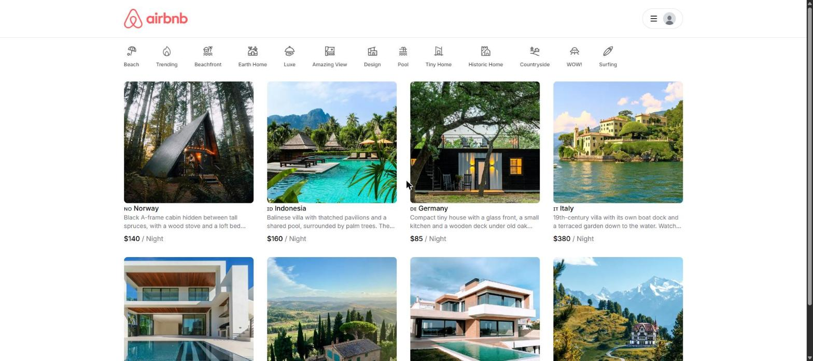
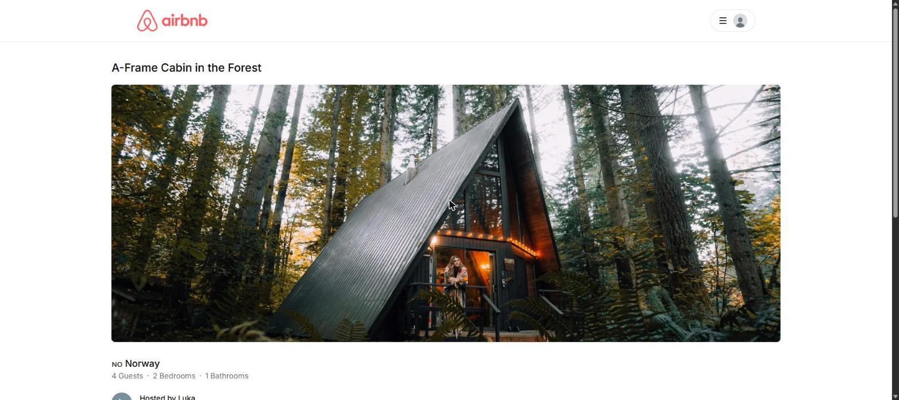
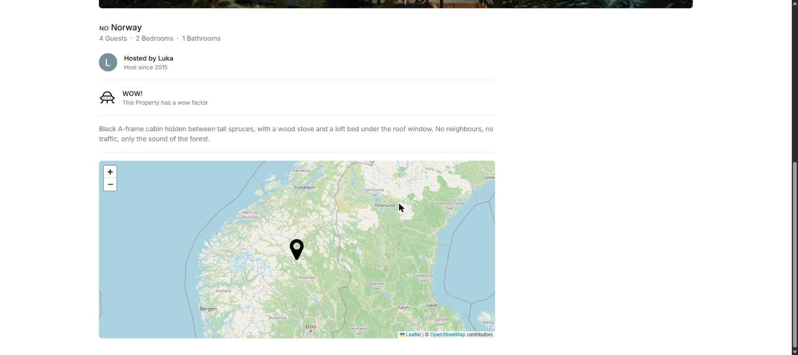

# Airbnb-Klon

> **Tutorial-Projekt, nach einem Video-Tutorial nachgebaut.**
> Der Grundaufbau stammt aus einem YouTube-Tutorial. Im November 2026 wurde das Projekt
> repariert und für ein Live-Deployment vorbereitet (siehe
> [„Nachträglich repariert“](#nachträglich-repariert-2026)).

Eine vereinfachte Airbnb-Kopie: Man meldet sich an, stellt die eigene Unterkunft in drei
Schritten ein (Kategorie, Beschreibung mit Foto, Land auf der Karte) und kann Inserate
anderer nach Kategorie filtern und als Favoriten speichern.

**Live-Demo:** [airbnb-klon-curioso.vercel.app](https://airbnb-klon-curioso.vercel.app)



| Detailseite | Gastgeber, Kategorie und Karte |
| --- | --- |
|  |  |

Die acht Demo-Inserate wurden über das normale Formular der App angelegt. Die Fotos stammen
von [Unsplash](https://unsplash.com) (Unsplash-Lizenz). Zum Ausprobieren von Inserat erstellen
und Favoriten braucht es ein Login (Google oder E-Mail über Kinde).

## Funktionen

- Login und Registrierung mit Kinde (E-Mail oder Social Login)
- Inserat erstellen in drei Schritten: Kategorie → Beschreibung, Preis, Foto → Land mit Karte
- Bild-Upload in Supabase Storage
- Startseite mit Filter nach Kategorie
- Detailseite mit Gastgeber, Kategorie und Leaflet-Karte (OpenStreetMap)
- Favoriten speichern und entfernen
- „My Listings“: eigene Inserate

**Nicht umgesetzt** (der Tutorial-Stand endet vorher): Suche, Reservierungen, Bearbeiten
und Löschen von Inseraten.

## Stack

| Bereich | Technik |
| --- | --- |
| Framework | Next.js 16 (App Router, Server Components, Server Actions, Turbopack), React 19, TypeScript |
| Styling / UI | Tailwind CSS, shadcn/ui (Radix UI), lucide-react |
| Datenbank | PostgreSQL bei Supabase, Prisma ORM |
| Bilder | Supabase Storage |
| Login | Kinde (`@kinde-oss/kinde-auth-nextjs`) |
| Karten | Leaflet / react-leaflet, Länderdaten aus `world-countries` |
| Hosting | Vercel (Region Frankfurt), täglicher Cron-Job gegen das Pausieren der Gratis-Datenbank |

## Lokal starten

Voraussetzungen: Node.js 24, ein kostenloses Supabase-Konto und ein kostenloses Kinde-Konto.

### 1. Installieren

```bash
git clone https://github.com/Curiosoofficial/airbnb.git
cd airbnb
npm install
```

`npm install` führt danach automatisch `prisma generate` aus (Script `postinstall`).

### 2. Supabase einrichten

1. Auf [supabase.com](https://supabase.com) ein neues Projekt anlegen und das Datenbank-Passwort notieren.
2. **Connect → ORMs → Prisma**: Die beiden Verbindungs-URLs kopieren.
   - `POSTGRES_PRISMA_URL` = Transaction Pooler (Port **6543**, mit `?pgbouncer=true&connection_limit=1`)
   - `POSTGRES_URL_NON_POOLING` = Session Pooler (Port **5432**)
3. **Project Settings → API Keys**: Projekt-URL und den geheimen `service_role` key (bzw. secret key) kopieren.

Die Variablennamen sind dieselben, die die Supabase-Integration von Vercel automatisch setzt.

### 3. Umgebungsvariablen

```bash
cp .env.example .env
```

Danach die Werte in `.env` eintragen. Jede Variable ist in [`.env.example`](.env.example) erklärt.

### 4. Datenbank-Tabellen anlegen

```bash
npm run db:push
```

Das ist `prisma db push`: Prisma erstellt die Tabellen `User`, `Home` und `Favorite` direkt nach
`prisma/schema.prisma`. Migrationsdateien gibt es in diesem Projekt keine.

### 5. Storage-Bucket und Sicherheit

Im Supabase-Dashboard den **SQL Editor** öffnen und den Inhalt von
[`supabase/setup.sql`](supabase/setup.sql) ausführen. Das Skript:

- legt den öffentlichen Bucket `images` an (max. 4 MB, nur Bilder),
- schaltet Row Level Security für die drei Tabellen ein. Prisma funktioniert weiterhin, aber über
  die öffentliche Supabase-API kann niemand mehr direkt Daten lesen.

### 6. Kinde einrichten

1. Auf [kinde.com](https://kinde.com) eine Business anlegen und darin eine Applikation vom Typ
   **Back-end web → Next.js**.
2. Client ID, Client Secret und Issuer URL (`https://<name>.kinde.com`) in `.env` eintragen.
3. Unter **Details → Callback URLs** eintragen:
   - Allowed callback URLs: `http://localhost:3000/api/auth/kinde_callback`
   - Allowed logout redirect URLs: `http://localhost:3000`

### 7. Starten

```bash
npm run dev
```

App läuft auf [http://localhost:3000](http://localhost:3000).

## Deployment auf Vercel

1. Repository auf [vercel.com/new](https://vercel.com/new) importieren (Framework wird automatisch erkannt).
2. **Storage → Create → Supabase** (Free Plan, Region Frankfurt) und die Datenbank mit dem Projekt
   verbinden. Vercel setzt `POSTGRES_PRISMA_URL`, `POSTGRES_URL_NON_POOLING`, `SUPABASE_URL` und
   `SUPABASE_SERVICE_ROLE_KEY` automatisch. Kein Schlüssel muss von Hand kopiert werden.
3. Tabellen anlegen: Das SQL aus `npx prisma migrate diff --from-empty --to-schema-datamodel prisma/schema.prisma --script`
   und danach [`supabase/setup.sql`](supabase/setup.sql) unter **Storage → Datenbank → Query** ausführen.
4. Die Kinde-Variablen unter **Settings → Environment Variables** eintragen.
   Die drei `KINDE_*_URL`-Werte zeigen auf die Vercel-Domain, z. B. `https://<projekt>.vercel.app`.
5. Deployen. Das Build-Script führt zuerst `prisma generate` aus und danach `next build`.
6. In Kinde die Vercel-Domain bei den Callback- und Logout-URLs eintragen
   (`https://<projekt>.vercel.app/api/auth/kinde_callback` und `https://<projekt>.vercel.app`).

`vercel.json` legt die Server-Funktionen nach Frankfurt (nah an der Datenbank) und startet
jeden Morgen den Cron-Job `/api/keepalive`. Er macht eine kleine Abfrage, damit Supabase das
Gratis-Projekt nicht nach 7 Tagen ohne Besucher pausiert.

## Nachträglich repariert (2026)

Das Projekt lief nach zwei Jahren nicht mehr. Diese Fehler wurden gefunden und behoben:

| Problem | Ursache | Lösung |
| --- | --- | --- |
| `npm run build` bricht ab: „supabaseUrl is required“ | Der Supabase-Client wurde schon beim Import erstellt. Ohne Env-Variablen crasht der Build. | Client wird erst beim ersten Upload erstellt (`getSupabase()` in `db/supabase.ts`). |
| Alle Bilder kaputt | Die URL des alten Supabase-Projekts war fest im Code und in `next.config.mjs`. | URL kommt aus `SUPABASE_URL` (`lib/imageUrl.ts`), `remotePatterns` erlaubt `*.supabase.co`. |
| Nach dem Login landet man auf `localhost` | Fester Redirect auf `http://localhost:3000/` in `api/auth/creation`. | Redirect relativ zur aktuellen Domain. |
| Sicherheitslücken in Next.js 14.2.3 | Veraltete Version, unter anderem eine kritische Lücke. | Update auf 14.2.35 (letzte 14er-Version), dazu `npm audit fix`. |
| Veralteter Prisma Client auf Vercel | Vercel cached `node_modules`, der generierte Client passt dann nicht mehr zum Schema. | `prisma generate` im `build`- und `postinstall`-Script. |
| Fremde Daten änderbar | Server Actions vertrauten einer `userId` aus versteckten Formularfeldern. Jeder hätte fremde Inserate oder Favoriten ändern können. | User-ID kommt immer aus der Kinde-Session, Updates prüfen den Besitzer. |
| Favorit entfernen schlug manchmal fehl | Die Favoriten-Seite nahm `Home.Favorite[0]`, das kann der Favorit eines anderen Users sein. | Eigene Favoriten-ID wird direkt geladen. |
| Upload grosser Fotos bricht ab | Server Actions erlauben standardmässig nur 1 MB. Dazu fester `contentType: "image/png"`, und Umlaute im Dateinamen führten zu „Invalid key“. | Limit 4 MB, echter Dateityp, zufälliger Dateiname (UUID). |
| Karte wird ständig neu aufgebaut, springt nicht zum gewählten Land | `dynamic()` wurde im Komponenten-Körper aufgerufen. `ssr: false` stand in einer Server-Komponente. | `dynamic()` auf Modul-Ebene in einer Client-Komponente, `Recenter` setzt die Ansicht neu. |
| Detailseite crasht | Ohne Kategorie fehlte das Bild-`src`. Profilbilder von fremden Hosts (z. B. `avatar.vercel.sh`) waren in Next nicht erlaubt. Bei unbekannter ID blieb die Seite halb leer. | Kategorie wird geprüft, Avatare `unoptimized`, `notFound()` bei unbekannter ID. |
| Kritische Sicherheitslücken trotz Update | Next.js 14 bekommt keine Fixes mehr. `npm audit` meldete u. a. Remote Code Execution in der Bildoptimierung. | Upgrade auf Next.js 16 und React 19: `params`/`searchParams` sind jetzt Promises (`await` bzw. `use()`), ESLint Flat Config statt `next lint`, react-leaflet 5. |
| Live-Demo wäre nach einer Woche tot | Supabase pausiert Gratis-Projekte nach 7 Tagen ohne Aktivität. | Täglicher Vercel-Cron auf `/api/keepalive`. |
| Upload brauchte eine offene Regel | Hochgeladen wurde mit dem öffentlichen anon key, dafür musste jeder in den Bucket schreiben dürfen. | Upload nur auf dem Server mit dem geheimen Service-Key, keine offene Upload-Regel mehr. |
| Kaputtes Profilbild für Gäste, toter Link | `/user.png` existierte nicht. „My Reservations“ führte auf eine 404-Seite. Platzhalter „Hello from search“ in der Navigation. | Vorhandenes Platzhalterbild, Link und Platzhalter entfernt. |

**Noch offen:** `npm audit` meldet Hinweise in Tailwind CSS 3 (Abhängigkeiten `picomatch`, `glob`).
Die laufen nur beim Bauen, nicht auf dem Server. Weg gehen sie erst mit Tailwind 4, das wäre
ein Umbau aller Styles.
